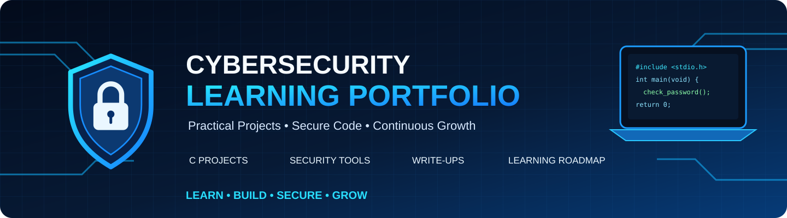
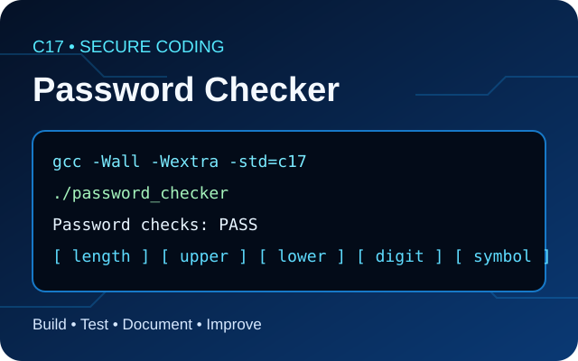

<div align="center">



# Cybersecurity Learning Portfolio

**Practical coursework · Secure coding fundamentals · Reproducible tests**

[](https://github.com/mukhtarprov1-hue/Cybersecurity-Learning-Portfolio/actions/workflows/ci.yml)
[](https://en.cppreference.com/w/c/17)
[](LICENSE)

</div>

A public, curated portfolio of cybersecurity learning projects. The goal is to show **what was built, how it is tested, what the result means, and what the limitations are**—without publishing private course materials, credentials, or lab access details.

## Featured project

### Password Checker in C



A small C17 console program that checks five explicit password rules: length greater than eight characters, an uppercase letter, a lowercase letter, a digit, and a punctuation symbol.

- **Source:** [`projects/password-checker-c/password_checker.c`](projects/password-checker-c/password_checker.c)
- **Build and usage:** [`projects/password-checker-c/README.md`](projects/password-checker-c/README.md)
- **Test cases:** [`projects/password-checker-c/tests/test_cases.csv`](projects/password-checker-c/tests/test_cases.csv)
- **Arabic test report:** [`projects/password-checker-c/docs/test-report-ar.md`](projects/password-checker-c/docs/test-report-ar.md)
- **Arabic demo notes:** [`projects/password-checker-c/docs/explain-to-instructor-ar.md`](projects/password-checker-c/docs/explain-to-instructor-ar.md)

The GitHub Actions workflow compiles with strict warnings and exercises accepted, rejected, and overlong input cases. Check the [latest workflow results](https://github.com/mukhtarprov1-hue/Cybersecurity-Learning-Portfolio/actions) for the actual CI status.

## Repository structure

```text
.
├── .github/workflows/ci.yml
├── assets/
│   ├── cybersecurity-icon.svg
│   ├── portfolio-banner.svg
│   └── projects/password-checker-card.svg
├── docs/
│   ├── learning-roadmap.md
│   └── project-evidence-policy.md
├── projects/
│   └── password-checker-c/
│       ├── docs/
│       ├── tests/
│       ├── password_checker.c
│       └── README.md
├── .gitattributes
├── .gitignore
├── CONTRIBUTING.md
├── LICENSE
├── README.md
└── SECURITY.md
```

## Quality and safety principles

- Document requirements and limitations instead of overstating capabilities.
- Distinguish **expected results** from **observed results**.
- Include reproducible build and test commands.
- Use sample data only; never commit real passwords, API keys, access tokens, recovery codes, private invitations, or personal files.
- Perform security tests only in systems and environments where permission has been granted.
- Keep private trainer slides, answer keys, and course-only resources out of this public repository unless redistribution is expressly allowed.

## About

Maintained by **Mukhtar Alawady** as a public learning portfolio in cybersecurity and networks. Projects are educational and should not be treated as production security products unless explicitly stated and independently validated.

## License

Project code and documentation are released under the MIT License. See [`LICENSE`](LICENSE). Third-party materials, if ever added, retain their own licenses and attribution requirements.
