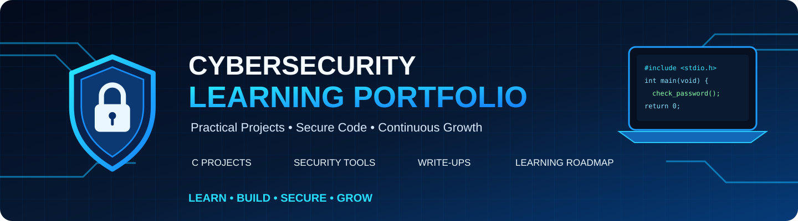
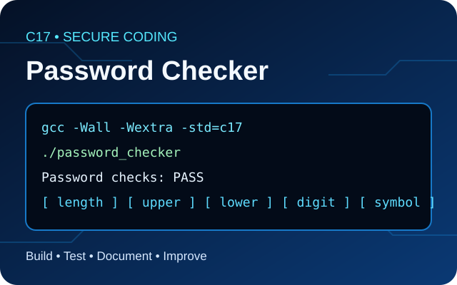

# Cybersecurity Learning Portfolio

**Practical coursework · Secure coding fundamentals · Reproducible tests**

A public, curated portfolio of cybersecurity learning projects. The goal is to show **what was built, how it is tested, what the result means, and what the limitations are**—without publishing private course materials, credentials, or lab access details.

## Public course assignments

The instructor-accessible collection is organized in the [public assignment and evidence index](course-assignments/README.md). It includes the public C, Python, PHP, and JavaScript assignments, with source code, reproducible tests, Arabic documentation, and execution evidence.

### Recently integrated assignments

| Assignment | Project | Main focus | Review |
|---|---|---|---|
| 10 | Secure HTTP Request Handler & REST API | PHP, HTTP methods, JSON validation, Bearer authorization, CRUD, audit logging | [Assignment 10](course-assignments/10-php-rest-api/README.md) |
| 11 | SQL Injection Defense | PHP, PDO, SQLite, prepared statements, safe/unsafe query comparison | [Assignment 11](course-assignments/11-sqli-defense/README.md) |
| 12 | Secure File Upload | PHP upload validation, Fileinfo, file signatures, private storage, layered controls | [Assignment 12](course-assignments/12-secure-file-upload/README.md) |
| 13 | Session & Cookie Security | PHP sessions, HttpOnly, Secure, SameSite, session rotation, CSRF | [Assignment 13](course-assignments/13-session-cookie-security/README.md) |
| 14 | DOM Interaction & DOM-XSS Defense | JavaScript DOM sinks, textContent, sandbox isolation, Playwright browser tests | [Assignment 14](course-assignments/14-dom-xss-defense/README.md) |

[Open the complete public assignment index](course-assignments/README.md)

[Hex Viewer source](course-assignments/03-hexadecimal-viewer/hex_viewer.c) · [Arabic report](course-assignments/03-hexadecimal-viewer/docs/REPORT_AR.md) · [Execution screenshots](course-assignments/03-hexadecimal-viewer/screenshots/)

## Featured project

### Password Checker in C

A small C17 console program that checks five explicit password rules: length greater than eight characters, an uppercase letter, a lowercase letter, a digit, and a punctuation symbol.

- **Source:** [password_checker.c](projects/password-checker-c/password_checker.c)
- **Build and usage:** [Project README](projects/password-checker-c/README.md)
- **Test cases:** [CSV test cases](projects/password-checker-c/tests/test_cases.csv)
- **Arabic test report:** [Test report](projects/password-checker-c/docs/test-report-ar.md)
- **Arabic demo notes:** [Instructor notes](projects/password-checker-c/docs/explain-to-instructor-ar.md)

The GitHub Actions workflow compiles with strict warnings and exercises accepted, rejected, and overlong input cases. Check the [latest workflow results](https://github.com/mukhtarprov1-hue/Cybersecurity-Learning-Portfolio/actions) for the actual CI status.

## Repository structure

    .
    ├── .github/workflows/
    ├── assets/
    ├── docs/
    ├── course-assignments/
    │   ├── 01-password-checker/
    │   ├── 03-hexadecimal-viewer/
    │   ├── 04-log-file-parser/
    │   ├── 05-multithreaded-port-scanner/
    │   ├── 06-banner-grabbing-tool/
    │   ├── 07-automated-log-analyzer/
    │   ├── 08-password-generator-sha256-hasher/
    │   ├── 09-file-integrity-monitoring/
    │   ├── 10-php-rest-api/
    │   ├── 11-sqli-defense/
    │   ├── 12-secure-file-upload/
    │   ├── 13-session-cookie-security/
    │   ├── 14-dom-xss-defense/
    │   └── README.md
    ├── projects/
    │   └── password-checker-c/
    ├── .gitattributes
    ├── .gitignore
    ├── CONTRIBUTING.md
    ├── LICENSE
    ├── README.md
    └── SECURITY.md

## Quality and safety principles

- Document requirements and limitations instead of overstating capabilities.
- Distinguish **expected results** from **observed results**.
- Include reproducible build and test commands.
- Use sample data only; never commit real passwords, API keys, access tokens, recovery codes, private invitations, or personal files.
- Perform security tests only in systems and environments where permission has been granted.
- Keep private trainer slides, answer keys, and course-only resources out of this public repository unless redistribution is expressly allowed.
- A successful GitHub merge or CI run does not mean that a trainer has graded or accepted an assignment.

## About

Maintained by **Mukhtar Alawady** as a public learning portfolio in cybersecurity and networks. Projects are educational and should not be treated as production security products unless explicitly stated and independently validated.

## License

Project code and documentation are released under the MIT License. See [LICENSE](LICENSE). Third-party materials, if ever added, retain their own licenses and attribution requirements.
