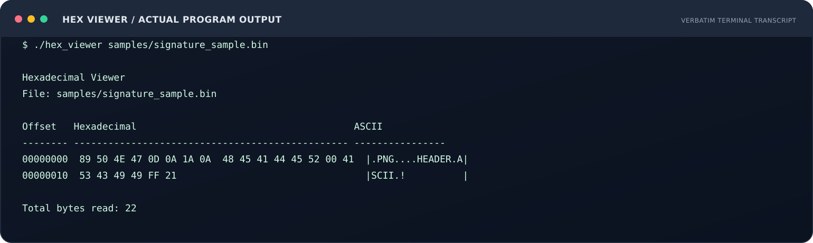
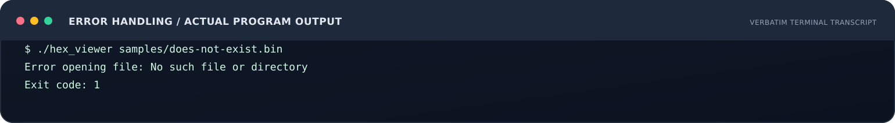
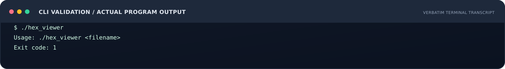
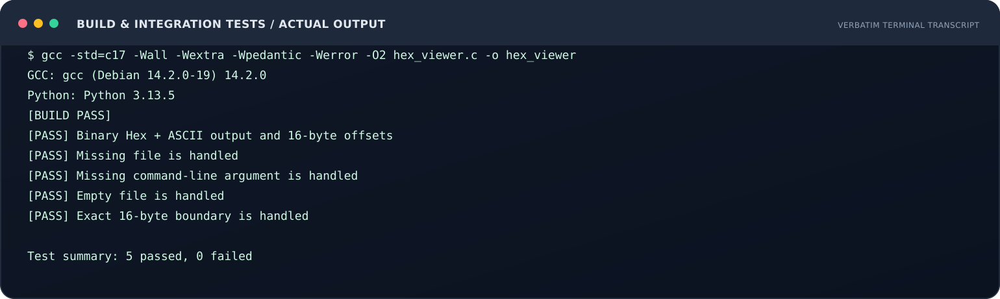

# Assignment 03 — Hexadecimal Viewer (C17)

> **Course:** Cybersecurity Camp 2026  
> **Learner:** Mukhtar Alawady  
> **Task:** 03 · **Language:** C17 · **Interface:** CLI  
> **Implementation status:** Implemented  
> **Local verification:** Build successful · 5/5 integration tests passed  
> **Hosted CI:** SUCCESS — [GitHub Actions run 42074047078](https://github.com/mukhtarprov1-hue/Cybersecurity-Learning-Portfolio/actions/runs/42074047078)  
> **Course submission:** Discord thread link is listed below; GitHub publication alone is not proof of a Discord submission.

## Instructor quick access

| Open this | What it contains |
|---|---|
| [Task specification (Arabic)](TASK_SPEC_AR.md) | Task purpose, exact functional requirements, acceptance points |
| [C source](hex_viewer.c) | Complete implementation |
| [Requirements traceability](docs/TRACEABILITY.md) | Requirement → code → test → evidence |
| [Arabic technical report](docs/REPORT_AR.md) | Design, implementation, test results, limitations |
| [Reviewer guide (Arabic)](docs/REVIEWER_GUIDE_AR.md) | Rebuild and review in a few minutes |
| [Integration tests](tests/run_tests.py) | Five repeatable tests |
| [Execution evidence](evidence/) | Raw terminal logs |
| [Hosted CI evidence](evidence/hosted-ci-run.md) | Successful GitHub-hosted build and test run |
| [Execution captures](screenshots/) | SVG renders of terminal output, labelled honestly |
| [GitHub Actions workflow](../../.github/workflows/hex-viewer-c.yml) | Automated build/test definition |

## 1. Objective and result

A C17 command-line program reads a binary file in blocks of up to 16 bytes. For every byte it prints a two-digit uppercase hexadecimal value and a corresponding ASCII character when the byte is within the printable range 32–126; all other values appear as a dot. The program also displays the byte offset and total bytes read.

## 2. Trainer's brief

Read [TASK_SPEC_AR.md](TASK_SPEC_AR.md) for the task description and the acceptance points supplied for this assignment. The matrix in [TRACEABILITY.md](docs/TRACEABILITY.md) ties each requirement to code and verification evidence.

## 3. Build and run

### Linux / Kali Linux

    gcc -std=c17 -Wall -Wextra -Wpedantic -Werror -O2 hex_viewer.c -o hex_viewer
    python3 samples/create_sample.py
    ./hex_viewer samples/signature_sample.bin
    python3 tests/run_tests.py ./hex_viewer

### Windows / MSYS2 UCRT64

    gcc -std=c17 -Wall -Wextra -Wpedantic -Werror -O2 hex_viewer.c -o hex_viewer.exe
    python samples/create_sample.py
    ./hex_viewer.exe samples/signature_sample.bin
    python tests/run_tests.py ./hex_viewer.exe

GCC and Python are only needed for building/testing; the compiled viewer itself has no third-party runtime dependencies.

## 4. Verified output

The synthetic sample is 22 bytes long. Its first eight bytes are the PNG signature. The local reference run produced two rows at offsets 00000000 and 00000010, replacing NUL and 0xFF with dots, and reported:

    Total bytes read: 22

## 5. Test results

| Test | Expected behavior | Recorded result |
|---|---|---|
| Binary Hex/ASCII + partial row | correct 16-byte grouping, ASCII, and total | PASS |
| Missing file | error and non-zero exit | PASS |
| Missing argument | Usage and non-zero exit | PASS |
| Empty file | successful run, total 0 | PASS |
| Exact 16-byte file | one row only, total 16 | PASS |

**Local reference result:** build passed, 5 passed / 0 failed. See [build-and-test.log](evidence/build-and-test.log) for compiler/runtime versions and output. See [TRACEABILITY.md](docs/TRACEABILITY.md) for test-to-requirement mapping. The GitHub-hosted CI run also completed successfully: [run 42074047078](https://github.com/mukhtarprov1-hue/Cybersecurity-Learning-Portfolio/actions/runs/42074047078).

## 6. Evidence gallery

### Sample binary output

### Missing file handling

### Argument validation

### Automated tests

**Evidence note:** These SVG files are rendered terminal transcripts derived from the corresponding text logs, not raw screenshots captured from the learner's Windows desktop. The raw logs are linked in the evidence folder and can be reproduced with the commands above.

## 7. Project structure

    03-hexadecimal-viewer/
    ├── README.md
    ├── TASK_SPEC_AR.md
    ├── hex_viewer.c
    ├── samples/
    ├── tests/
    ├── docs/
    │   ├── REPORT_AR.md
    │   ├── TRACEABILITY.md
    │   └── REVIEWER_GUIDE_AR.md
    ├── evidence/
    ├── screenshots/
    └── tools/

## 8. Limitations and safe use

- Read-only: the program does not modify the inspected file.
- It does not execute or parse the contents of files.
- A magic-byte signature is a useful clue, not proof of file integrity or safety.
- ASCII rendering follows the task's 32–126 range; it does not decode UTF-8 or other character encodings.
- The sample file is synthetic. Do not publish private, sensitive, or unauthorized files as examples.

## 9. Submission channel

The assignment-specific Discord thread supplied for this task is:

[Open Assignment 03 submission thread](https://discord.com/channels/838962253855588402/1567925953827573790)

**Submission state:** Public GitHub package prepared. The learner must still post this link in the Discord thread; no Discord submission or trainer acceptance is claimed by this repository.
