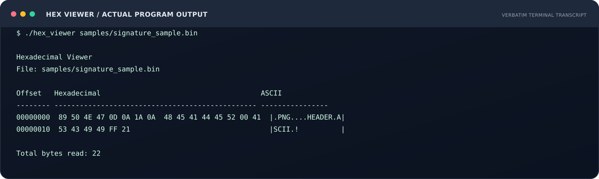
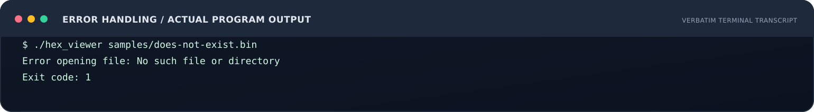
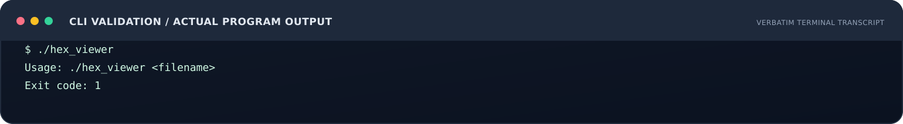
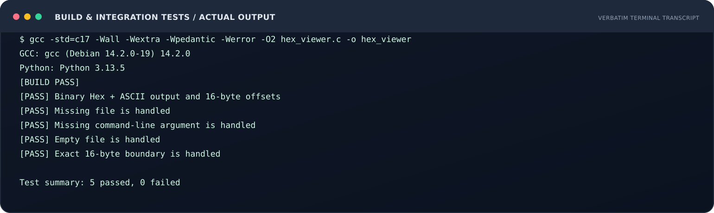

# تقرير التكليف الثالث
## عارض الملفات الثنائية بصيغة Hexadecimal Viewer

**المسار التدريبي:** معسكر الأمن السيبراني 2026  
**رقم التكليف:** 03  
**لغة البرمجة:** C (C17)  
**نوع التطبيق:** Command-Line Interface (CLI)  
**إعداد:** Mukhtar Alawady  
**حالة التنفيذ:** مكتمل — مع اختبار محلي موثق

---

## 1. الملخص التنفيذي

تم تطوير أداة سطر أوامر بلغة C لقراءة الملفات الثنائية وعرض محتوياتها الخام. تعرض الأداة كل مجموعة من البيانات في صف يضم حتى 16 بايتاً، وتقدم لكل بايت تمثيلاً سداسياً عشرياً وتمثيلاً نصياً ASCII بجواره. كما تعرض Offset للصف، وتتعامل مع حالات الملف غير الموجود، وغياب وسيط اسم الملف، والملف الفارغ، والصف الأخير الذي لا يكتمل إلى 16 بايتاً.

## 2. هدف التكليف

فهم كيفية التعامل مع الملفات الثنائية في لغة C، والتمييز بين القراءة النصية والقراءة الثنائية، واستخدام تمثيل Hexadecimal وASCII للمساعدة في الفحص الأولي لترويسات الملفات (File Headers) والتوقيعات (File Signatures).

## 3. بيئة التنفيذ

| العنصر | القيمة |
|---|---|
| اللغة | C17 |
| المترجم | GCC |
| خيارات البناء | -Wall -Wextra -Wpedantic -Werror -O2 |
| أداة الاختبار | Python 3 — اختبار تكاملي عبر subprocess |
| الاعتماديات | مكتبة C القياسية فقط؛ Python مطلوب للاختبارات وليس لتشغيل الأداة |

تم التحقق من الحزمة فعلياً في بيئة Linux باستخدام GCC 14.2.0 وPython 3.13.5. لم يتم الادعاء بأن التنفيذ جرى على جهاز Windows المحلي؛ أوامر MSYS2 موضحة لإعادة الاختبار هناك.

## 4. تصميم الحل

1. يتحقق البرنامج من أن المستخدم مرر اسم ملف واحداً من خلال argc وargv.
2. يفتح الملف باستخدام fopen() والوضع rb للمحافظة على البايتات كما هي.
3. يقرأ حتى 16 بايتاً في كل دورة باستخدام fread().
4. يطبع Offset ثم القيم السداسية باستخدام %02X مع المحافظة على عرض ثابت لكل خانة.
5. يعرض بايتات ASCII القابلة للطباعة، من 32 إلى 126، ويستبدل بقية القيم بنقطة.
6. يتحقق من أخطاء القراءة بواسطة ferror() ثم يغلق الملف بواسطة fclose().
7. يعرض إجمالي عدد البايتات التي تمت قراءتها.

## 5. قرارات التنفيذ

- نوع المصفوفة unsigned char حتى تمثل القيم من 0x00 إلى 0xFF دون تفسيرها كقيم سالبة.
- استخدم fread(buffer, 1, sizeof buffer, file) لأن قيمة الإرجاع تمثل عدد البايتات المقروءة، وليس عدد العناصر متعددة البايتات.
- لا يفترض البرنامج أن كل قراءة ستعيد 16 بايتاً؛ لذلك يتعامل مع عدد البايتات الفعلي في كل صف.
- تُطبع مسافات بديلة في الخانات الناقصة من الصف الأخير حتى يظل عمود ASCII بمحاذاة عمود Hex.
- لا تتم طباعة البايتات غير القابلة للطباعة مباشرة، بل تستبدل بنقطة.

## 6. نتائج التنفيذ الفعلية

تم بناء البرنامج، ثم تشغيله على عينة ثنائية اصطناعية من 22 بايتاً تتضمن توقيع PNG في بدايتها، ونصاً قابلاً للطباعة، وبايت NUL، وبايتاً غير ASCII. كما تم تشغيل حالات خطأ الإدخال والملف الفارغ وحدود الصف.

| رقم | الاختبار | النتيجة المرصودة |
|---|---|---|
| T-01 | عرض Hex وASCII لعينة ثنائية | PASS |
| T-02 | إظهار خطأ عند غياب الملف | PASS |
| T-03 | إظهار Usage عند غياب الوسيط | PASS |
| T-04 | قراءة ملف فارغ | PASS |
| T-05 | ملف حجمه 16 بايتاً بالضبط | PASS |

**الحصيلة:** 5 اختبارات ناجحة من أصل 5.  
**البناء:** نجح GCC مع تفعيل التحذيرات واعتبارها أخطاء (-Werror).

الصور التالية تمثيل بصري حرفي (verbatim render) لسجلات مخرجات الطرفية الناتجة عن تشغيل البرنامج والاختبارات؛ وليست صور شاشة أصلية من جهاز Windows. سجلات الطرفية النصية الأصلية متاحة في مجلد `evidence/` ويمكن إعادة إنتاجها بالأوامر المذكورة لاحقاً.

### صورة 1 — مخرجات فحص العينة



### صورة 2 — معالجة الملف غير الموجود



### صورة 3 — التحقق من الوسائط



### صورة 4 — الاختبارات الآلية



سجلات التنفيذ النصية الأصلية متاحة في مجلد evidence/ لإعادة المراجعة.

## 7. قراءة توقيع PNG

التوقيع القياسي الذي يبدأ به ملف PNG هو:

89 50 4E 47 0D 0A 1A 0A

ظهور هذه القيم في أول ثمانية بايتات يساعد في التعرف الأولي على نوع الملف، بينما قد تظهر في عمود ASCII نقاط بدلاً من بعض هذه القيم لأن عدداً منها غير قابل للطباعة. لا يكفي التوقيع وحده لإثبات سلامة الملف أو موثوقيته؛ يجب فحص البنية والسياق ومصدر الملف عند الحاجة.

## 8. معالجة الأخطاء

- وسيطات غير صحيحة: رسالة استخدام إلى stderr ورمز خروج غير ناجح.
- فشل فتح الملف: perror() مع رمز خروج غير ناجح.
- فشل القراءة: فحص ferror() وتحديث حالة الخروج.
- فشل الإغلاق: فحص قيمة fclose() وتحديث حالة الخروج.

## 9. حدود الحل

هذه أداة تعليمية للفحص الأولي وليست محللاً كاملاً لصيغ الملفات. لا تتحقق من سلامة بنية PNG أو PDF، ولا تفك الضغط، ولا تستخرج البيانات الوصفية، ولا تحكم على كون الملف خبيثاً أو سليماً. كما أن عرض ASCII مخصص للمجال القابل للطباعة وفق النطاق المحدد في التكليف (32–126)، ولا يحاول تفسير UTF-8 أو ترميزات أخرى.

## 10. إعادة الإنتاج

من مجلد المشروع:

```bash
gcc -std=c17 -Wall -Wextra -Wpedantic -Werror -O2 hex_viewer.c -o hex_viewer
python3 samples/create_sample.py
./hex_viewer samples/signature_sample.bin
python3 tests/run_tests.py ./hex_viewer
```

في Windows/MSYS2 يمكن استبدال اسم الملف التنفيذي بـ hex_viewer.exe واستخدام python بدلاً من python3 حسب الإعداد المحلي.

## 11. الخلاصة

ينفذ البرنامج الوظائف الأساسية المطلوبة في التكليف: استقبال اسم الملف، وفتحه ثنائياً، وقراءة 16 بايتاً في كل دورة، وعرض Hex وASCII بمحاذاة، ومعالجة الخطأ وإغلاق الملف. وتم التحقق من الوظائف عبر خمسة اختبارات تكاملية ناجحة. يوفر المشروع كذلك خطوات إعادة بناء واختبار واضحة، وصوراً توثيقية للمخرجات، وحدوداً صريحة لما يمكن استنتاجه من توقيعات الملفات.
