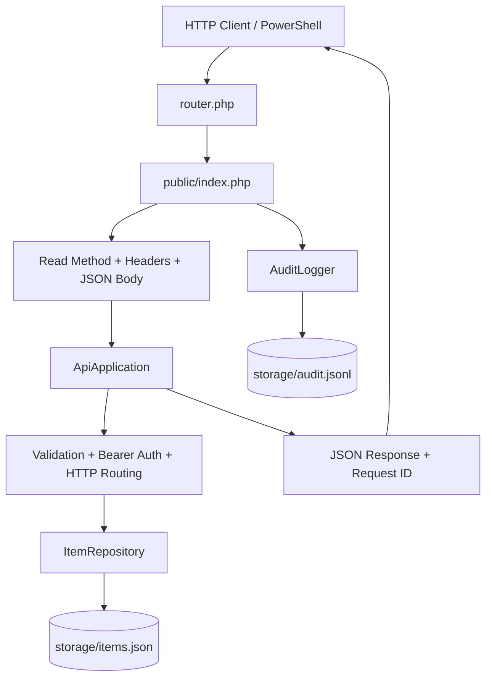

# Architecture Overview

The public directory is the only web document root. Runtime storage and source classes remain outside it. The local built-in server router sends API paths to the front controller.
